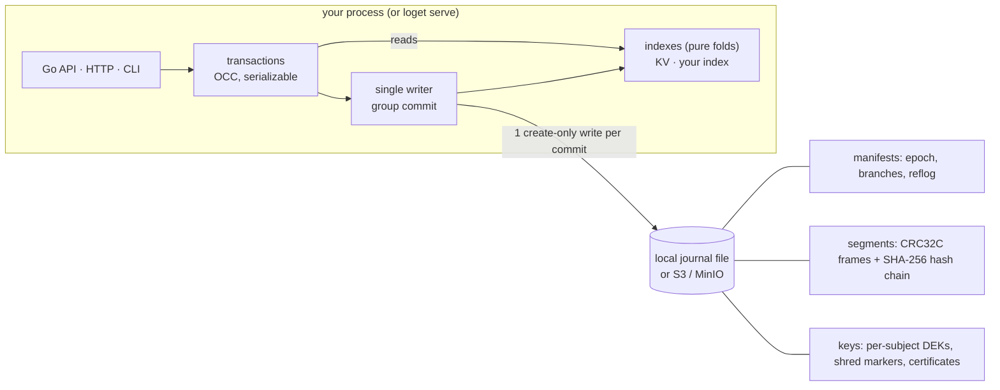

<p align="center">
  
</p>

<h3 align="center">One log, different indexes over it.</h3>

<p align="center"><i>LogEt (Danish/Norwegian "the log"; "et" also means "one").</i></p>

<p align="center">
An embedded KV store built as an index over one append-only log, on a local
disk or object storage,<br>with transactions, branches, time travel and
provable deletion. More indexes come one at a time.
</p>

<p align="center">
  <a href="https://github.com/raman20/loget/actions/workflows/ci.yml"></a>
  <a href="https://pkg.go.dev/github.com/raman20/loget"></a>
  <a href="LICENSE"></a>
</p>

<p align="center">
  <a href="https://raman20.github.io/loget/">Website</a> ·
  <a href="docs/index.md">Docs</a> ·
  <a href="#quickstart">Quickstart</a> ·
  <a href="#go-api">Go API</a> ·
  <a href="#indexes">Indexes</a> ·
  <a href="#benchmarks">Benchmarks</a> ·
  <a href="#status">Status</a> ·
  <a href="docs/ROADMAP.md">Roadmap</a>
</p>

> [!WARNING]
> **Pre-1.0 and unreleased. Do not use it in production.** No LogEt
> version has been tagged. The log, transactions, branches and shred are
> model-checked and simulation-tested, but steady memory is still ~5–10×
> Pebble's, full scans are 3–5× slower, only MinIO is tested among object
> stores (no real-world deployment), there is no replication, and the
> on-disk format may change before 1.0. Gaps by area:
> [docs/PRODUCTION_READINESS.md](docs/PRODUCTION_READINESS.md).

---

## What it is

LogEt stores everything in **one append-only log**: CRC-framed,
hash-chained segments on a local disk (one journal file) or in an S3
bucket. An **index** is a pure, deterministic fold over that log. The
built-in index is **KV**: MVCC key/value records with prefix scans and
time travel. Because every index folds the same log, they all get the
same things for free:

- **Transactions.** Serializable optimistic concurrency (OCC) with a
  single writer and group commit. `Update` retries on conflict.
- **Branches and time travel.** A branch is "parent log + LSN", so no data
  is copied. Read any LSN, rewind a branch, promote one onto another.
- **Provable deletion.** `shred alice` deletes Alice's data key. Her values
  become unreadable on every branch and at every LSN; you get a signed
  certificate and the hash chain still verifies.
- **Simple operations.** One static Go binary (no CGO), one URL (`./data`
  or `s3://bucket/prefix`). No brokers, no Raft, no ZooKeeper.

**The plan: make KV as good as it can be first, then add indexes one at a
time** (topics, documents, vectors, full-text...), each through the same
framework and the same testing bar. See [docs/PIPELINE.md](docs/PIPELINE.md).

## Install

There is no release yet. Build from source (Go 1.27+):

```sh
git clone https://github.com/raman20/loget && cd loget
go build -o loget ./cmd/loget && ./loget version
```

Or `go install github.com/raman20/loget/cmd/loget@main`. As a Go library:
`go get github.com/raman20/loget@main`.

## Quickstart

Copy-paste. It uses `./loget-data` by default (on Linux/macOS a new
directory gets the one-file journal layout). Outputs are from a real run.

```console
$ loget put greeting "hello"
{"lsn":1}
$ loget put greeting "hello, world"
{"lsn":2}
$ loget get greeting --at 1                    # time travel
hello
$ loget put user/u17/email alice@example.com --subject alice
{"lsn":3}
$ loget tx '[{"op":"put","key":"stock/apple","value":"9"},{"op":"put","key":"order/1","value":"apple"}]'
{"lsn":4,"ops":2}
$ loget scan stock/
[{"key":"stock/apple","value":"9"}]

$ loget branch create exp                      # zero-copy branch
{"heads":{"exp":4,"main":4},"ok":true}
$ loget put stock/apple 0 --branch exp
{"lsn":5}
$ loget get stock/apple
9
$ loget put stock/apple 1000                   # a bad write on main...
{"lsn":5}
$ loget rewind main 4                          # ...undone; old head kept in the reflog
{"heads":{"exp":5,"main":4},"ok":true}
$ loget get stock/apple
9

$ loget shred alice                            # forget alice, provably
{"certificate":{"branch":"main","dek_deleted":true,"indexes_purged":["kv"],"shred_lsn":5,…},"valid_signature":true}
$ loget get user/u17/email
error (404): loget: not found
$ loget verify                                 # CRCs, hash chains, fencing, shred proofs
{… "encrypted_values":1, "ok":true, "unreadable_shredded_values":1 …}
```

(The shred and verify output is trimmed; hashes and signatures differ on
every run.)

**On S3** (same commands, different URL):

```sh
export AWS_ACCESS_KEY_ID=… AWS_SECRET_ACCESS_KEY=…
export LOGET_URL='s3://my-bucket/app1?endpoint=127.0.0.1:9000&insecure=1&create=1'   # MinIO example
loget put hello world
```

**As a server** (the CLI and the server share one code path):

```sh
loget serve --db ./loget-data --listen 127.0.0.1:7070 &
export LOGET_ADDR=http://127.0.0.1:7070          # the CLI now talks to the server
loget put k v
curl -s localhost:7070/v1/kv/k                     # v
```

> Opening a database takes the write lease and **fences every other
> writer**. While a server runs, point the CLI at it (`--addr` /
> `LOGET_ADDR`) instead of opening the same URL.

More: [getting-started](docs/getting-started.md),
[operations](docs/operations.md).

## Go API

From [`examples/tour`](examples/tour/main.go) (`go run ./examples/tour`):

```go
db, _ := loget.Open(ctx, "./data", loget.WithIndex(counter.Kind()))   // or "s3://…", "mem://x"

db.Put(ctx, "config/model", []byte("small"))
db.Update(ctx, func(tx *loget.Tx) error {                 // serializable, retried on conflict
    tx.Put("user/alice/email", []byte("alice@example.com"), loget.Subject("alice"))
    return tx.Put("users", []byte("1"))
})
db.View(ctx, func(tx *loget.Tx) error {
    kvs, _ := tx.Scan("user/")
    n, _ := counter.Count(tx, "lunch", "tacos")             // a second index over the same log
    ...
})

main := db.Branch("main")
good, _ := main.Head()
main.ViewAt(ctx, good, func(tx *loget.Tx) error { ... })  // time travel
db.CreateBranch(ctx, "experiment", "main", good)          // zero-copy branch
db.Rewind(ctx, "main", good)                              // undo

cert, _ := db.Shred(ctx, "alice")                         // forget, with a signed certificate
report, _ := db.Verify(ctx)
```

```
kv: config/model = small
scan user/: 2 keys, first user/alice/email
index: lunch votes map[soup:1 tacos:1]
time travel: at LSN 3 config/model = small
rewind: main config/model = small (old head kept in reflog)
branch: experiment config/model = medium
shred: certificate for LSN 4, DEK deleted=true, signed=true
after shred: user/alice/email -> loget: not found, lunch votes map[soup:1]
after shred: new write for alice -> loget: subject has been crypto-shredded
verify: ok=true
```

**HTTP API** (JSON; `?branch=`, `?subject=` on writes, `?at=` for time travel):

| Endpoint | Purpose |
|---|---|
| `GET/PUT/DELETE /v1/kv/{key}`, `GET /v1/kv?prefix=&start=&end=&reverse=&limit=&after=` | KV |
| `POST /v1/tx` | atomic batch of `put` / `del` |
| `GET/POST /v1/branches`, `DELETE /v1/branches/{b}`, `POST /v1/branches/{b}/rewind`, `POST /v1/branches/{b}/promote` | branches |
| `GET /v1/log`, `POST /v1/shred/{subject}`, `GET /v1/verify` | raw log, forget, audit |
| `POST /v1/compact`, `POST /v1/gc?keep-for=24h`, `POST /v1/backup` | maintenance |
| `GET /healthz`, `GET /readyz`, `GET /metrics` | health, readiness, Prometheus |

Errors: `404` not found, `409` conflict (retry), `410` subject shredded or
history compacted away, `503` fenced by a newer writer.

[`examples/agent-demo.sh`](examples/agent-demo.sh) runs an AI agent's
memory, tasks, undo, branches and forget against the server
([output](examples/agent-demo.out)).

## Indexes

An index is a Go package registered with `loget.WithIndex(kind)`. It
declares the key spaces it owns, folds committed records with `Apply`,
drops a shredded subject with `DropSubject`, and may snapshot its state
so open does not replay the whole log. The core gives it transactions,
branches, time travel, compaction and shred. KV itself is an index.

- **How to write one:** [docs/index-authoring.md](docs/index-authoring.md),
  walking through [`examples/counter`](examples/counter) (a counter index
  with eight tests and a fuzzer).
- **Which come next and when:** [docs/PIPELINE.md](docs/PIPELINE.md).
  Topics, documents, vectors and cross-index transactions exist on
  `index/*` branches from LogEt's predecessor and will be ported one at a
  time, after KV.

## How it works



- **Writes** are validated (OCC) by the single writer, then group-committed
  as one segment: one `write` + `fdatasync` on the journal, or one
  create-only PUT on S3. A write is acked only after that.
- **Fencing without clocks.** `Open` creates the next manifest with
  `epoch+1`; create-only writes mean exactly one opener wins, and a zombie
  writer stops with `ErrFenced`.
- **Indexes** are pure folds over `redact(log, shredded)`; a test enforces
  that index code imports nothing that could observe the outside world.
- **Compaction** folds a log into a base (a key run in pieces plus value
  chunks; chunks still mostly live are shared with the next base, not
  copied) and deletes replaced objects after a grace period; `gc` keeps a
  time-travel window. Open loads the newest index checkpoint and replays
  only the tail.

More: [architecture](docs/architecture.md), [formats](docs/formats.md).

## Guarantees

| | Guarantee |
|---|---|
| Durability | A transaction is acked only after its segment is durable (journal record `fdatasync`'d, file fsync'd and linked, or S3 PUT succeeded). |
| Atomicity | All of a transaction's ops appear, or none. |
| Isolation | Serializable per branch: one writer, OCC read-set validation. |
| Fencing | After a newer `Open` succeeds, an older writer can never commit again. |
| Recoverability | Damage is reported (`ErrCorrupt`, `ErrVersion`), never silently dropped. |
| Index consistency | Every index equals `fold(redact(log, shredded))`, after restarts, snapshots, branches and rewinds. |
| Shred | After `Shred(s)` returns, no value written with subject `s` is returned on any branch at any LSN, and new writes for `s` are refused. |

**Not guaranteed:** keys and values written *without* a subject are not
encrypted and are not affected by shred; backups or versioned buckets
holding the data key defeat shred; there is no high availability (one
writer per database); the crash test uses kill -9, and power loss is
modelled separately. Details: [docs/security.md](docs/security.md).

## Correctness evidence

| Method | What | Result |
|---|---|---|
| **TLA+ / TLC** ([spec/](spec), [results](spec/RESULTS.md)) | LogEtLog (fencing, recovery, torn tails, checkpoints) | 22,587,747 states, no error |
| | LogEtTxn (serializable OCC) | 21,685,744 states, no error |
| | LogEtBranch, LogEtShred, LogEtMigrate, LogEtCompact, LogEtGC, LogEtGrow, LogEtNotify | no error; several found design bugs before code |
| **Simulator** ([sim/](sim)) | seeded workloads with crashes and injected faults; KV and the counter index checked against a model after every recovery | 2,000 seeds in CI |
| **Property tests** | `index == fold(log)`, snapshot + tail == fold, `DropSubject == fold(redacted)`, compressed key runs refine a map model | in CI |
| **Fuzzing** | segment, payload, manifest and KV snapshot decoders, the counter's `Restore` | clean after fixing every finding |
| **Crash tests** | kill -9 with concurrent writers; a power-loss model with torn and reordered sectors | all acked writes recovered |

The state counts above are from LogEt's predecessor freshDB, whose log and
transaction code LogEt keeps unchanged apart from the rename; the specs
were re-run under their new names (see [spec/RESULTS.md](spec/RESULTS.md)).
The specs are bounded and matched to the code by hand, so nothing is
proven equivalent to the code.

```sh
go test -race ./...                                    # everything
go test ./sim -run TestSimulation -seeds=10000         # more simulator seeds
spec/get_tla.sh && TLA_JAR=~/tla/tla2tools.jar spec/run_tlc.sh
```

## Benchmarks

> **Single runs on a shared, noisy 8-vCPU VM; embedded Go engines; not a
> performance claim.** Method and raw data: [docs/benchmarks.md](docs/benchmarks.md),
> [bench/results](bench/results/). These runs were made on freshDB, before
> the rename, with the same KV write and read path.

**KV against Pebble at 10M keys × 100 B** (same box, single runs; LogEt with its key
index in mapped run files; per-item sources in [docs/STATUS.md](docs/STATUS.md)
and [bench/results](bench/results/)):

| | LogEt | Pebble | |
|---|---:|---:|---|
| YCSB C (read-only), 8 clients | **1.65M ops/s** | 0.20M ops/s | LogEt ahead while the index pages are resident |
| Peak RSS (load + C + A) | **557 MiB** | 737 MiB | |
| Steady RSS after the run | 490 MiB (274 bounded mode) | **52 MiB** | LogEt ~5–10× worse |
| Open | 1.97–2.19 s | **< 0.2 s** | ~10× worse |
| Full scan (iterator) | 1.54M keys/s | **7.28M keys/s** | 3–5× slower |
| Bulk ingest (sorted) | 1.45M keys/s, 172 MiB | **3.96M keys/s, 46 MiB** | 2.7× slower |
| Batches of 1,000 | 335k keys/s | **2.09M keys/s** | 6× slower |
| Compaction, 1% churn | 6.7 s, 213 MiB written | background, incremental | LogEt rewrites the whole key run each time |

Older YCSB at 1M × 1 KiB (zipfian, fsync on, ops/s, made on freshDB before
the rename; [`2026-10-28-read-path/`](bench/results/2026-10-28-read-path/),
[`2026-10-27/`](bench/results/2026-10-27/)):

| | LogEt | Badger | Pebble | bbolt | SQLite |
|---|---:|---:|---:|---:|---:|
| C (read-only), 8 clients | **1.83M** | 261k | 197k | 752k | 37k |
| A (50% update), 64 clients | **231k** | 25k | 119k | 24k | 13k |
| Peak RSS | 1.55 GiB | 3.5 GiB | 0.7 GiB | 1.7 GiB | **0.3 GiB** |

**Where LogEt still loses:** steady memory (the mapped index pages and
the Go heap stay resident; Pebble relies on the page cache), open time
(the checkpoint is O(index)), full scans, bulk writes, and compaction work
that is still O(keys) (the key run is rewritten whole; only value chunks
are shared). Point reads lead only while the index fits in memory.

The full list, ordered by impact against Pebble, RocksDB and LMDB, is in
[docs/ROADMAP.md](docs/ROADMAP.md).

## Status

**Done** (per-item numbers in [docs/STATUS.md](docs/STATUS.md)): KV
roadmap items 1–4: key index in memory-mapped run files, iterators with
batched value reads, batches and sorted bulk ingest, open from index
checkpoints, memory work at 10M keys, per-key TTL and snapshot handles,
value chunks shared across compactions. Earlier: journal layout, off-heap
value cache, compaction and GC with retention windows, online
backup/restore and point-in-time restore, metrics, scoped tokens and TLS,
S3 fault injection, format versioning with golden files, a 6 h soak, the
index framework.

**Not done:** compaction that avoids rewriting the whole key run, steady
memory and open time close to Pebble, faster scans, testing on AWS S3 or
R2 or any real-world deployment, replication/HA, KMS clients. See
[docs/ROADMAP.md](docs/ROADMAP.md).

## Deployment notes

- **URLs:** `./dir` or `file:///abs/path` (journal layout for new
  directories on Linux/macOS/BSD, files layout on Windows),
  `journal:///p` / `fs:///p` to force a layout,
  `s3://bucket/prefix?endpoint=host:port&insecure=1&create=1`, `mem://name`.
  S3 credentials come from `AWS_ACCESS_KEY_ID` / `AWS_SECRET_ACCESS_KEY`.
- **Object stores** must support create-only writes (`If-None-Match: *`).
  MinIO is tested in CI; run `loget s3check` against anything else.
- **Single writer** per database; shard by database to scale.
- **Growth:** `loget gc --keep-for 24h` (or `serve --gc-every 1h`) drops
  overwritten, deleted and shredded data while keeping a time-travel
  window. The journal file shrinks only with an offline `loget gc --shrink`.
- **Keys:** `--kek-file` / `LOGET_KEK` or a Go `KeyProvider`. Without one
  the database runs in dev-key mode (key stored next to the data) and
  logs a warning.
- **Server:** binds `127.0.0.1` by default; a non-loopback `--listen`
  needs `--token` / `--token-file` (or `--insecure-no-auth`).

Full guide: [docs/operations.md](docs/operations.md). Vulnerabilities:
please report privately, see [SECURITY.md](SECURITY.md).

## Project

- [docs/index.md](docs/index.md): map of all documentation
- [docs/ROADMAP.md](docs/ROADMAP.md) · [docs/PIPELINE.md](docs/PIPELINE.md) · [docs/STATUS.md](docs/STATUS.md)
- [CONTRIBUTING.md](CONTRIBUTING.md) · [CHANGELOG.md](CHANGELOG.md) · [GOVERNANCE.md](GOVERNANCE.md) · [CODE_OF_CONDUCT.md](CODE_OF_CONDUCT.md) · [SECURITY.md](SECURITY.md)

```
*.go       engine: open/fencing, writer + group commit, transactions, records, branches, shred/verify, compaction
index/     the index framework (Kind, Index, Registry) and the KV index
format/    segment + payload encoding (CRC32C, hash chain), fuzz targets
store/     journal, fs, s3, mem, faulty (fault injection); layout detection + migrate
server/    HTTP API             cmd/loget/   the single binary
sim/       deterministic simulator
spec/      TLA+ specs + TLC results
examples/  tour, counter index, agent demo
bench/     loget-bench suite (separate module) + results
```

*LogEt succeeds freshDB (this repository was freshDB until the rename; see [docs/rebrand/](docs/rebrand/)).*

## License

Apache License 2.0. See [LICENSE](LICENSE).
