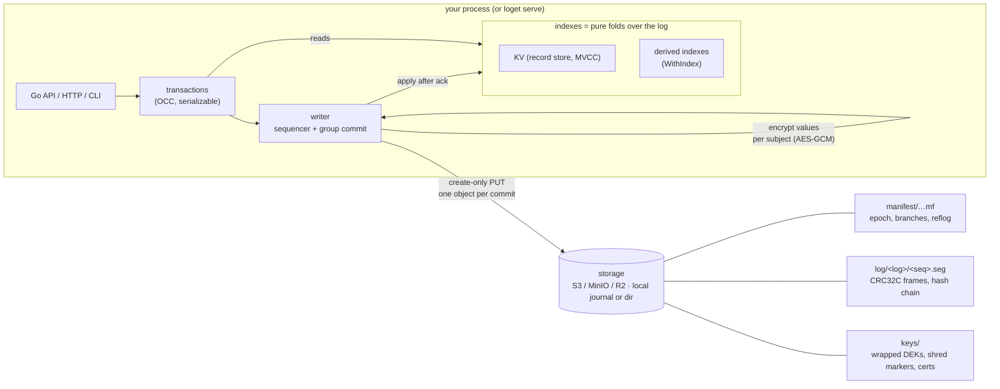

# Architecture

> Status: describes `main` (pre-1.0, unreleased; KV is the only built-in
> index). See [formats.md](formats.md) for byte layouts and
> [operations.md](operations.md) for running it.

## The pieces

**Store** (`store/`). The only interface to the outside world. Besides
get/list/delete and ranged reads, it has one key primitive: `PutIfAbsent`
(create-only). Implementations:
- **S3** (`s3://`): `PUT` with `If-None-Match: *`; ranged `GET` for reads.
- **Journal** (`journal://`, and the default for new local directories on
  Unix): every object is a record in one preallocated append-only file,
  `journal.fj`, indexed in memory. A create-only put is one `write` plus one
  `fdatasync`. An exclusive `flock` guards writers.
- **Files** (`fs://`, and the Windows default): one file per
  object, written as a temp file plus `renameat2(RENAME_NOREPLACE)` (or
  `link`), with fsync of the file and the directory.
- `mem://` for tests, and `store.Faulty`, which wraps any store to inject
  failed, lost, delayed, duplicated and torn writes for the simulator.

`store.OpenLocal` picks the local layout: an existing directory keeps its
own, and `loget migrate` converts offline (model-checked in
`spec/LogEtMigrate.tla`; see [design 01](design/01-journal-default.md)).

**Manifest** (`manifest.go`). A small JSON document holding the writer epoch,
the logs (each with an optional parent and fork LSN), branch refs → log ids,
the reflog and garbage awaiting deletion. Manifests are numbered densely
(`manifest/00000000000000000007.mf`) and are only ever *created*, never
overwritten. Whoever creates id N+1 owns the database from then on.

**Open and fencing** (`db.go`, `log.go`). `Open` reads the latest manifest and
creates the next one with `epoch+1`. Because the write is create-only, exactly
one concurrent opener wins. It then recovers each log it will write to:

1. List and read segments in sequence order.
2. Verify CRCs and the hash chain.
3. Damage in any segment is an error (`ErrCorrupt`): every store writes
   objects atomically, so a damaged segment is corruption and may hold
   acknowledged commits. Only with `WithRepairTail` / `--repair-tail` is a
   damaged *final* segment accepted: its valid prefix is used, the object
   stays as is, and a create-only repair note records the decision. A segment of an unknown version is `format.ErrVersion`, and a log
   that ends before its snapshot's LSN is `ErrCorrupt` (design 12).
4. If it sees any segment from a *newer* epoch, it stops with `ErrFenced` and
   writes nothing. TLC found this race; see [spec/RESULTS.md](../spec/RESULTS.md).
5. It writes an empty *fence* segment with its own epoch at the next sequence
   number.

From then on, an older writer (a "zombie") fails its next create-only segment
write, or sees the newer epoch, and stops with `ErrFenced`.

**Writer** (`writer.go`). There is one writer per log. Transactions run
optimistically against a snapshot, and at commit the writer validates their
read sets (OCC), which makes them serializable. Hot keys cannot starve:
transactions that already lost a conflict are validated first in the next
batch and back off with jitter, and after 3 lost conflicts the body runs on
the writer itself at the applied head, so it commits on that attempt.
Several such escalated transactions can share a batch; one that conflicts
with an earlier write in the batch moves to the next. It then assigns LSNs and
encrypts subject-tagged values. All transactions that arrive within a batch
become **one segment object** (group commit). A transaction is acknowledged
only after that object is durable. If a PUT's outcome is unknown (for example
a timeout), the writer reads the object back. If it still can't tell, it
returns `ErrUnknownOutcome` and never acks.

**Indexes** (`index/`, `records.go`). The log carries records
`(space, key, value, subject)`; each index kind declares the key spaces it
owns (`index.Kind`, registered with `WithIndex`). All records are stored
in one MVCC record store, the KV structure (`index/kv.go`): recent
versions in a hash map, older ones frozen into immutable, front-coded,
hash-indexed runs that merge incrementally
([components/kv.md](components/kv.md)). KV itself is a record store with
the `kv` space. A *derived* index additionally folds its records into its
own state; the core replays the compaction base and the log into it. See
[index-authoring.md](index-authoring.md) and
[design 20](design/20-index-framework.md). Index state lives in memory,
with one exception: the KV index keeps values larger than `InlineMax` (64 B) as a
position (segment, offset, length, CRC-32C) in their immutable segment, and
reads them back on demand through the **value cache** (`vcache.go`: 64
shards of byte rings in one off-heap `mmap` arena, default 256 MiB,
`WithValueCacheBytes`). Every value read from storage is CRC-checked before
it is returned or cached, and values are copied on the way in and out.
Index state can be checkpointed to `snap/` (`WithSnapshotEvery`, off by
default): the KV image plus one section per derived index that can
snapshot. Checkpoints are an optimisation, never the source of truth.

**Branches** (`branch.go`). A branch is a log with a parent and a fork LSN, so
creating one copies no data. Reads on a branch see the parent's entries up to
the fork LSN, then the branch's own. *Rewind* creates a new log forked from the
target LSN and moves the ref; the old head goes into the reflog, so nothing is
deleted. *Promote* points one branch name at another's log. *Time travel*
(`ViewAt`) reads any branch as of any LSN.

**Shred** (`shred.go`, `keyring.go`). Each subject gets its own data key (DEK),
stored in `keys/dek/<hash>` wrapped by the key-encryption key (KEK). Subject
names are hashed before they reach the log. `Shred(subject)` does four things,
each one crash-safe:

1. Write a shred marker.
2. Delete the DEK.
3. Append an audit `SHRED` entry to the log.
4. Return an ed25519-signed certificate (subject hash, LSN, chain head,
   manifest id).

Indexes drop the subject (`DropSubject` ≡ folding the redacted log), and
ciphertext stays in old segments. Because the hash chain covers the stored
ciphertext, it still verifies. `Verify` re-checks everything and sweeps any
DEK that landed late.

**Compaction** (`compact.go`). For each log it writes a *base image* at the
head (the latest live version of every record, large values in ≤ 64 MiB
chunks), then, with commits briefly paused, commits
one create-only manifest that points the log at its base, drops the parent
link and lists the replaced segments, bases and snapshots as garbage with a
not-before time (the grace period). Due garbage, and orphan bases from an
older epoch, are swept at the next compaction. Reads below the base return
`ErrCompacted` (HTTP 410). The protocol is model-checked in
[`spec/LogEtCompact.tla`](../spec/LogEtCompact.tla); details in
[design/03-compaction.md](design/03-compaction.md).

## Why one log is enough for cross-index transactions

Every index's records are entries in the same log, and a transaction
commits as one frame. So a transaction that writes KV and, say, a
consumer group's cursor (when topics return, [PIPELINE.md](PIPELINE.md))
commits entirely or not at all, with no outbox and no two-phase commit.
The LogEtTxn TLA+ model checks this with a consume-and-ack workload
(`ExactlyOnce`, `AtomicCursor`).

## What runs where

- **Embedded:** `loget.Open(ctx, url)` in your Go process. This is the fastest
  path and has no network hop.
- **Server:** `loget serve` exposes the same engine over JSON/HTTP. The CLI talks
  to it with `--addr`.
- **CLI without `--addr`:** opens the database itself (embedded). That takes
  the write lease and fences any running server on the same URL.
